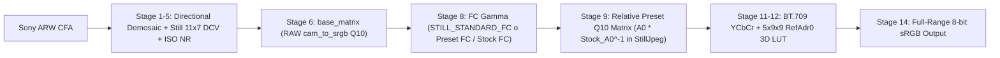

# Plan: Maximizing Film Simulation Quality & Look Lab Still-ISP Parity

## Goal Description

When opening a RAW photo (`_DSC1738.ARW`) in **BIONZ Look Lab** (`./isp-studio/`) and selecting **Gold 200** (or any of the 7 presets in `mods/film_sims/presets/`), the left side (*Emulated / Fine-tuned*) appears heavily blown out, pale, milky, and green-shifted compared to the right side (*Stock (.jpg)*), with $\Delta E_{2000}$ mean `15.64` / p95 `28.03`.

Root-cause analysis of `isp-studio/crates/bionz-app/src/main.rs`, `isp-studio/crates/bionz-preset/src/lib.rs`, `isp-studio/crates/bionz-fit/src/lib.rs`, and `mods/film_sims/film_recipes_3d.py` identified four compounding defects:

1. **Wrong Gamma & Matrix Domain in `GammaPath::StillJpeg` for Side A (Look) vs Side B (Stock):**
   - In `isp-studio/crates/bionz-app/src/main.rs` (`LabApp::effective`), when `GammaPath::StillJpeg` is selected on a RAW file:
     - **Side B (`stock = true`)** sets `base_matrix = cam_to_srgb`, `color_matrix = identity`, bypasses `EC` (`bypass[6] = true`), enables `FC` (`bypass[7] = false`) using `STILL_STANDARD_FC`, and uses full range (`legal_range = false`).
     - **Side A (`stock = false`, `custom_ec = true`)** enters the `else` branch: it enables `EC` (`bypass[6] = false`), bypasses `FC` (`bypass[7] = true`), sets `legal_range = true`, and applies `base_matrix = cam_to_srgb` **AND** `color_matrix = table.a0` (`M_look @ STOCK_A0`).
   - Because `IntegerParams::default()` uses the logarithmic Movie S-Log3 `EC_RECORD31_EXPONENTS` knot positions (`[4, 8, 12, ..., 288 at knot 48, ..., 8191]`) on `0..=8191` input, feeding a uniform 96-knot curve into `sample_knots` maps **3.5% linear sensor light (`288 / 8191`) to knot 48 (>50% output brightness)**, blowing out highlights and midtones.
   - Applying `cam_to_srgb` in Stage 6 (`base_matrix`) and `table.a0` (`M_look @ STOCK_A0`) in Stage 9 applies the camera's `STOCK_A0` green-boost/red-attenuation matrix **a second time** on top of already-calibrated sRGB.

2. **Shipped `.bzlook` Presets Use Synthetic Linear Identity Stock Instead of Real `av-cam.bin` Stock (`flags = 1`):**
   - All 7 `.bzlook` files in `mods/film_sims/presets/` were generated by `a6400-lut-converter/tools/export_golden.py` using `synthetic_stock()` (`ec_stock[i] = i * 1023 / 95`, `fc_stock[i] = i * 1023 / 95`, `flags = FLAG_SYNTHETIC_STOCK`).
   - Because `flags = 1`, `Pack for Film Sims` in Look Lab and `bionz-cli pack` refuse to pack them for the camera (protecting against Imaging Hazard H01).

3. **Recipe Mathematical & Colorimetric Flaws in `FilmRecipe3D` / `bionz-fit::Recipe`:**
   - **C1 slope discontinuity at `crossover`:** Above `xc`, `t^k / (t^k + (1-t)^k)` has derivative `0` at `t = 0` (`x = xc`) whenever `mid_contrast > 1.0`, creating a flat kink at the shadow-to-midtone transition.
   - **Row-sum normalization cancels `warmth` in `_look_matrix`:** Adding `1 + warmth` to row 0 and `1 - warmth` to row 2 and dividing each row by `m.sum(axis=1)` cancels out the diagonal scaling on neutral grays and distorts cross-channel ratios on saturated tones.
   - **Aggressive recipe defaults:** Combined `warmth = 0.115`, `red_amber = 0.22`, `green_olive = 0.12`, `black_fade = 0.022`, and `highlight_warmth = 0.07` shift skin tones and highlights toward yellow-green while lifting blacks excessively.

4. **Missing Automated End-to-End Evaluation of Film Presets on Real ARW Shots in `bionz-cli`:**
   - `bionz-cli` lacks a `preset-eval` command and still-path preset rendering flags to benchmark all `.bzlook` presets on real `.ARW` photos.

---

## Architecture Target



---

## Proposed Changes

### Phase 1: Fix `StillJpeg` Pipeline in BIONZ Look Lab & `bionz-cli`

#### [MODIFY] `isp-studio/crates/bionz-preset/src/lib.rs`
- Add `still_jpeg_params_from_compiled(table: &CompiledTables, cam_to_srgb: Option<[i32; 9]>) -> IntegerParams`:
  - Computes the preset's relative tone transfer from `table.fc` relative to `table.stock_fc` and composes it onto `bionz_core::STILL_STANDARD_FC`.
  - When `cam_to_srgb` is present and the preset does not embed a custom `base_matrix`, sets `params.base_matrix = cam_to_srgb` and sets `params.color_matrix` to the preset's **relative Q10 look matrix** $M_{\text{rel}} = M_{\text{sim}} \cdot M_{\text{stock}}^{-1}$ (row-sum preserved to `1024`), matching `mods/film_sims/studio_core.py`.
  - Sets `params.bypass[6] = true`, `params.bypass[7] = false`, `params.legal_range = false`.
- Embed verified `av-cam.bin` stock tables (`EC_REC28_V1`, `FC_TBL0`, `STOCK_A0`, `STOCK_A1`, `STOCK_B2`, SHA-256 `dd8f8d0c...`) so Look Lab and `bionz-cli` preserve real camera stock tables.

#### [MODIFY] `isp-studio/crates/bionz-app/src/main.rs`
- Update `LabApp::effective` for `GammaPath::StillJpeg` to use `still_jpeg_params_from_compiled` for Side A (`Look`), aligning Side A and Side B to the same physical Still JPEG domain on RAW files.

#### [MODIFY] `isp-studio/crates/bionz-cli/src/main.rs`
- Add `--gamma-path <still-jpeg|movie-ec|still-fc>` and `--iso-model` to `bionz-cli render`.
- Add `bionz-cli preset-eval` subcommand to evaluate `.bzlook` presets on `.ARW` inputs (neutral axis drift, skin-tone hue/chroma stability, shadow/highlight retention, LUT rail margins, and side-by-side PNG exports).

---

### Phase 2: Upgrade 3D Tone Curve & Color Math (`film_recipes_3d.py` & `bionz-fit`)

#### [MODIFY] `mods/film_sims/film_recipes_3d.py`
#### [MODIFY] `isp-studio/crates/bionz-fit/src/lib.rs`
1. **$C^1$-Smooth Filmic H-D Tone Curve (`_filmic_tone_vec` / `filmic`):**
   - Replace the discontinuous power curve at `crossover` with a $C^1$-continuous filmic S-curve with matched slope through `crossover`, smooth `shadow_toe` bend, and smooth `highlight_rolloff` shoulder.
2. **White-Point-Preserving Gamut & Warmth Matrix (`_look_matrix` / `look_matrix`):**
   - Separate primary hue rotation (`red_amber`, `green_olive`, `blue_cyan`, exact row sum `1.0`) from chromatic warmth and luminance-tapered split toning with `skin_protect` so neutral grays and highlights stay clean.
3. **Colorimetric Calibration of the 7 Film Presets (`RECIPES_3D`):**
   - **Gold 200:** Clean black point (`black_fade = 0.006`), natural contrast (`mid_contrast = 1.10`, `shadow_toe = -0.06`, `highlight_rolloff = 0.36`), golden-amber warmth in highlights/warm midtones (`warmth = 0.045`, `highlight_warmth = 0.038`), `skin_protect = 0.88`, `saturation = 1.08`, `red_amber = 0.14`, `green_olive = 0.05`, `sky_luma = -0.07`.
   - **Portra 400:** Gentle toe and long highlight roll-off (`shadow_toe = 0.05`, `mid_contrast = 0.98`, `highlight_rolloff = 0.52`, `black_fade = 0.006`), natural warm skin (`skin_protect = 0.92`, `warmth = 0.030`, `red_amber = 0.08`, `green_olive = 0.09`, `highlight_warmth = 0.025`).
   - **Classic Chrome:** Documentary contrast (`shadow_toe = -0.15`, `mid_contrast = 1.18`, `highlight_rolloff = 0.44`, `black_fade = 0.004`), restrained chroma (`saturation = 0.78`), deeper teal-slate skies (`sky_luma = -0.16`, `sky_sat = -0.18`, `blue_cyan = 0.16`), muted olive foliage (`green_olive = 0.14`, `foliage_sat = -0.20`), `skin_protect = 0.82`.
   - **Classic Neg:** Punchy contrast (`shadow_toe = -0.18`, `mid_contrast = 1.24`, `black_fade = 0.008`), cool cyan-green shadow split (`shadow_warmth = -0.035`, `shadow_tint = -0.025`), warm copper highlights (`highlight_warmth = 0.038`, `red_highlight_hue = 0.18`).
   - **Vision3 800T:** Tungsten balance (`shadow_toe = -0.12`, `mid_contrast = 1.15`, `warmth = -0.055`, `shadow_warmth = -0.045`, `highlight_warmth = 0.045`, `red_highlight_hue = 0.16`).
   - **ETERNA:** Wide-latitude cinema curve (`shadow_toe = 0.12`, `mid_contrast = 0.85`, `highlight_rolloff = 0.65`, `black_fade = 0.014`, `white_ceiling = 0.965`, `saturation = 0.70`, `highlight_desat = 0.42`).
   - **ACROS B&W:** Fine monochrome gradation (`shadow_toe = -0.16`, `mid_contrast = 1.22`, `highlight_rolloff = 0.36`, `black_fade = 0.0`, `white_ceiling = 0.996`), panchromatic weights `[0.36, 0.53, 0.11]`, `sky_luma = -0.16`, `red_luma = 0.10`, tuned for `clamped_nodes = 0` and `at_rail_nodes = 0`.

---

### Phase 3: Recompile `.bzlook` Presets with Real Camera Stock & Sync Headers

#### [MODIFY] `a6400-lut-converter/tools/export_golden.py`
#### [MODIFY] `isp-studio/crates/bionz-app/src/looks.rs`
#### [MODIFY] `mods/film_sims/presets/*.bzlook`
#### [MODIFY] `mods/film_sims/live_picker/film_sim_live_data.h`
- Compile all 7 `.bzlook` presets in `mods/film_sims/presets/` at `33x33x33` LUT resolution against the real hash-verified `av-cam.bin` stock tables (`flags = 0`, `avcam_sha256 = dd8f8d0c...`) for both `a6400` and `a6100` targets, with real rendered thumbnails (`thumb.png`).
- Keep synthetic golden vectors in `artifacts/tests/bionz-golden/` deterministic for unit tests, and update `looks::tests` so all 7 shipped presets pass `looks::pack()` out of the box.
- Regenerate `mods/film_sims/live_picker/film_sim_live_data.h` via `mods/film_sims/studio_core.py --emit-live-header`.

---

## Verification Plan

### Automated Tests
1. Rust workspace tests:
   ```powershell
   cargo test --manifest-path isp-studio/Cargo.toml --workspace -q
   ```
2. Python Film Sim Studio tests:
   ```powershell
   .\venv\Scripts\python.exe -m unittest tests/test_a6100_film_sim_studio.py -v
   ```
   Verifies monotone `EC`/`FC` 96-knot curves, exact row-sum invariance of `A0`/`A1`/`B2`, zero rail/clamped nodes, and valid C headers for `a6400` and `a6100`.
3. End-to-end ARW evaluation via `bionz-cli`:
   ```powershell
   cargo build --manifest-path isp-studio/Cargo.toml -p bionz-cli --release
   .\isp-studio\target\release\bionz-cli.exe preset-eval "E:\DCIM\100MSDCF\_DSC1738.ARW" --presets mods/film_sims/presets -o isp-studio/target/preset-eval
   ```

### Manual Verification
- Open `E:\DCIM\100MSDCF\_DSC1738.ARW` in BIONZ Look Lab, verify all 7 presets in `Split` and `Side by side` views against `Stock (.jpg)`, and confirm `Pack for Film Sims` succeeds without synthetic-stock errors.

---

## Status (2026-11-22)

Phases 1–3 implemented and verified offline; evidence in [E0682](evidence/0682-still-jpeg-film-look-domain-and-recipe-recalibration.md).

- **Phase 1:** `still_jpeg_params_from_compiled`/`apply_still_jpeg_look` (cam `base_matrix`, relative Q10 matrix with 1024 row sums, relative FC composed onto `STILL_STANDARD_FC`, EC bypassed) is used by `bionz-app` side A and by `bionz-cli render --gamma-path still-jpeg`. Gold 200 on `_DSC1738`: legacy 17.09/33.31 → **8.26/21.57** ΔE2000 (stock side 7.41/20.23). `preset-eval` added, plus `render --gamma-path`/`--iso-model`/`--dcv-gain`.
- **Phase 2:** C¹ Hermite tone curve, row-stochastic look matrix with a luma-tapered `warmth` tint, and the recalibrated seven recipes (Python and Rust bit-matched; Python golden fixtures regenerated).
- **Phase 3:** the seven `.bzlook` presets re-fitted at 33³ against the hash-verified a6400 `av-cam.bin` (`flags = 0`, thumbnails, fit reports; Gold 200 mean ΔE76 0.83, 0 clamped/rail nodes), `film_sim_live_data.h` regenerated, and `looks::pack()` succeeds for all seven. **a6100 stays blocked:** `artifacts/a6100-inputs/av-cam.bin` is absent, so `export_golden.py` reports the skip rather than using synthetic stock.
- **Manual step remaining:** open the shot in BIONZ Look Lab and confirm visually, then the hardware A/B (no camera access was performed).
- **Follow-up (2026-11-22, E0683):** added an ARRI-style C¹ highlight shoulder to every recipe and six more Fujifilm simulations (Eterna Bleach Bypass, Pro Negative, Reala Ace, Velvia, Astia, Acros → 12 shipped looks, Stock + 12 in the live header). Targets follow the official Fujifilm descriptions; `preset-eval` shows the expected chroma ordering (Velvia highest, Bleach/Acros lowest). No vendor LUTs were redistributed; a6100 remains blocked on its av-cam capture.
