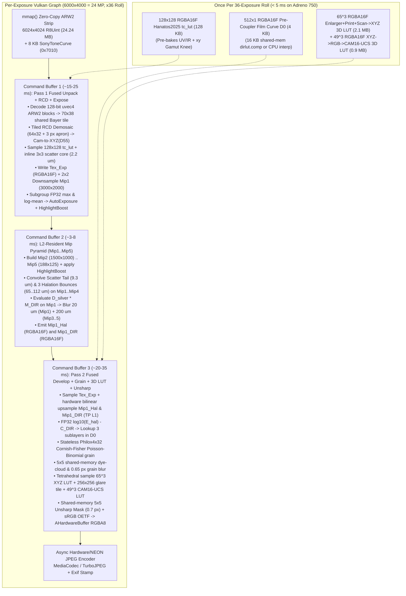

# E0688 - Candidate SpektraFilm Mobile GPU & 36-Exposure Film Roll Architecture for CinemaHUD Android

```text
ID: E0688
Date: 2026-11-24
Claim: Upstream SpektraFilm (andreavolpato/spektrafilm @ 3bb2c2d, v0.3.4) executes no runtime ODE or PDE chemical solvers; its photochemical model reduces to 81-band (380-780 nm) spectral contractions, 1D/2D/3D LUTs, 3-sublayer Poisson-Binomial grain draws, and linear shift-invariant Gaussian/exponential convolutions. For CinemaHUD Android (android/cinemahud/), film simulation splits cleanly into (1) live-view 3D .cube preview already supported by lib/cube_lut.dart and shaders/monitor.frag on Impeller/Vulkan, and (2) a candidate 3-pass NDK Vulkan 1.1/1.2 compute engine that unpacks 128-bit Sony ARW 2.3 (Compression=32767) cRAW blocks on the GPU, evaluates scatter/halation/DIR coupler diffusion on an RGBA16F mip pyramid, and bakes 81-band enlarger + print + scanner + CAM16-UCS gamut compression into a per-roll 65^3 + 49^3 3D LUT pair within a <160 MB (<114 MB 4-strip) memory ceiling, paired with zero-scratch camera-side roll transfer respecting BIONZ X's 8 MiB MemFree guard.
Status: offline codebase audit & candidate architecture (pinned source analysis of local repository @ e9508e0, spektrafilm @ 3bb2c2d, spektrafilm-rs @ 9dd59b0, vkdt @ a20d6f2, and rawspeed SonyArw2Decompressor; no physical camera execution or Android Vulkan compute prototype run yet)
Targets / environment:
  - Companion Android app: android/cinemahud/ (Flutter 3.47.9, Dart 3.13.7, Android SDK 36, NDK 28.2; baseline verified on Xiaomi 14 23127PN0CG, Android API 35, Qualcomm Adreno 750)
  - Host Rust/GPU workspace: isp-studio/crates/{bionz-raw,bionz-gpu,bionz-core,bionz-preset}
  - Camera bodies: Sony ILCE-6400 2.00, ILCE-6400A 1.01, ILCE-6100 1.00 (CXD90045, IMX284 6024x4024 / 6000x4000 14-bit RGGB ARW 2.3 cRAW)
Source:
  - Local: android/cinemahud/{README.md,lib/cube_lut.dart,shaders/monitor.frag,android/app/src/main/kotlin/com/cinemahud/cinemahud_android/MainActivity.kt}, isp-studio/crates/{bionz-raw/src/lib.rs,bionz-gpu/src/lib.rs}, tools/native_camera/mlv2/card_read.c, tools/research/camera_transfer.py
  - Local evidence: E0073, E0505, E0600, E0601, E0643, E0657, E0658-E0664, E0680-E0687
  - External pinned sources:
      andreavolpato/spektrafilm @ 3bb2c2d2801ff68b92019cf1dbcbb133d60832bc (GPL-3.0 code; CC BY-SA 4.0 profiles)
      turbasvin/spektrafilm-rs  @ 9dd59b0380194b93686aaa230a8bb9680aa270a4 (GPL-3.0)
      hanatos/vkdt              @ a20d6f24d4927d5d3d59080645f7e3cff111d3aa (BSD-2-Clause code; CC BY-SA 4.0 LUT data)
      darktable-org/rawspeed    @ develop (src/librawspeed/decompressors/SonyArw2Decompressor.cpp, LGPL-2.1)
```

---

## 1. Problem Statement & Two-Tier Integration with `CinemaHUD Android`

The goal is an end-to-end BIONZ X "Film Roll Mode" workflow:
1. The photographer selects a film stock on a `CXD90045` body (`ILCE-6400`, `ILCE-6400A`, `ILCE-6100`), shoots a 36-exposure roll in `.ARW` RAW, and transfers the 36 exposures as a roll bundle to the phone.
2. Our Android application ([`android/cinemahud/`](../../android/cinemahud/README.md)) develops all 36 `.ARW` frames into final JPEGs on the phone's GPU using a physical/chemical film simulation modeled on [`andreavolpato/spektrafilm`](https://github.com/andreavolpato/spektrafilm).

Auditing `android/cinemahud/`, `isp-studio/`, and `andreavolpato/spektrafilm` shows that film simulation in `CinemaHUD Android` naturally divides into **two distinct execution tiers** matching live framing versus post-roll darkroom development:

| Tier | Use Case in `CinemaHUD Android` | Input Signal | Where It Runs | Required Changes |
| --- | --- | --- | --- | --- |
| **Tier 1: Live Viewfinder Film Preview** | Real-time framing over USB PTP (`054C:0CAA`) or PC bridge (`1024x576` / `1024x680` @ `24-46 stages/s`) while shooting the 36 exposures | 8-bit camera live-view JPEG (S-Log2 or Standard) | Existing Flutter Impeller fragment pipeline ([`lib/cube_lut.dart`](../../android/cinemahud/lib/cube_lut.dart) + [`shaders/monitor.frag`](../../android/cinemahud/shaders/monitor.frag)) + optional in-camera `FilmSimulations.mod` ([E0682](0682-still-jpeg-film-look-domain-and-recipe-recalibration.md), [E0686](0686-photo-movie-modes-and-dual-variant-presets.md)) | **Zero shader changes.** `cube_lut.dart` already parses `LUT_3D_SIZE` `2..65` `.cube` files (`DOMAIN_MIN`/`DOMAIN_MAX`, `rgbaFloat32` `N^2 x N` atlas) and trilinearly samples them in `monitor.frag::applyLut`. Deterministic per-pixel SpektraFilm stock+print looks (`lut_mode=True`) export directly to `33^3`/`65^3` `.cube`. |
| **Tier 2: 36-Exposure 24 MP `.ARW` Darkroom Engine** | Batch-developing 36 full-sensor `6000x4000` 14-bit `.ARW` exposures with optical scatter, multi-bounce halation, DIR coupler lateral inhibition, 3-sublayer silver-halide grain, and darkroom print/scan physics | `36 x 24.5 MB` Sony ARW 2.3 cRAW (`~885 MB` roll archive) | **Candidate Native Android Vulkan 1.1/1.2 Compute Module** (`NDK 28.2` C++/SPIR-V or shared Rust crate alongside [`isp-studio/`](../../docs/BIONZ_LOOK_LAB.md)) invoked via `MethodChannel` / `dart:ffi` inside an Android `mediaProcessing` Foreground Service | New native compute library (`libcinemahud_filmlab.so`) using Vulkan `sampler2D`/`sampler3D`, `f16vec4` compute shaders, `AHardwareBuffer` zero-copy output, and `AThermal_getThermalHeadroom` pacing. |

### Why Flutter `FragmentShader` (`runtime_effect.glsl`) Cannot Host Tier 2
Inspecting [`android/cinemahud/shaders/monitor.frag`](../../android/cinemahud/shaders/monitor.frag) confirms that Flutter runtime effects (`#include <flutter/runtime_effect.glsl>`) expose only 2D `sampler2D` fragment evaluation:
- No compute shaders (`gl_WorkGroupID`, `shared` tile memory, `barrier()`), preventing single-pass tiled demosaicing or fused `5x5` grain/unsharp stencils.
- No integer bitfield buffers (`uvec4` / `uint32`), preventing direct GPU unpacking of 128-bit Sony ARW 2.3 cRAW blocks (`textureGather` itself had to be emulated at texel centers in `monitor.frag:24-28`).
- No hardware `sampler3D` (`VK_IMAGE_TYPE_3D`) or `RGBA16F` mip-chain storage images; running 20+ full-resolution `6000x4000` `ui.Picture.toImage` passes on Flutter's UI raster thread would exceed mobile memory budgets and stall the UI.
- Conversely, `android/cinemahud/` already configures **Android NDK 28.2** and a dedicated native worker executor in [`MainActivity.kt`](../../android/cinemahud/android/app/src/main/kotlin/com/cinemahud/cinemahud_android/MainActivity.kt), making a native Vulkan compute engine a clean, modular addition.

---

## 2. Dissection of SpektraFilm (`andreavolpato/spektrafilm@3bb2c2d`) & Existing GPU Ports

### 2.1 Core Finding: Analytic Spectral-Spatial Pipeline, Not Runtime PDE Kinetics

Line-by-line inspection of `andreavolpato/spektrafilm` at commit `3bb2c2d2801ff68b92019cf1dbcbb133d60832bc` (`v0.3.4`) establishes that **SpektraFilm solves zero ODE systems (`solve_ivp`) and zero iterative reaction-diffusion PDEs at runtime**. All photochemical and optical stages are closed-form spectral contractions on `SPECTRAL_SHAPE = SpectralShape(380, 780, 5)` (**81 wavelengths** at `5 nm` steps, `config.py:6`), 1D curve lookups on `LOG_EXPOSURE = linspace(-3, 4, 256)` (`config.py:5`), 2D/3D LUTs, stateless per-pixel stochastic particle draws, and linear shift-invariant Gaussian/exponential convolutions:

1. **`filming.expose` (`runtime/stages/filming.py:52-134`, `utils/spectral_upsampling.py:100-415`):**
   - Scene-linear RGB converts to CIE XYZ (CAT16-adapted to the film reference illuminant, e.g., `D55` for `kodak_portra_400.json`), splitting into brightness $b = X + Y + Z$ and chromaticity $(x, y) = (X, Y) / \max(b, 10^{-10})$, mapped onto $[0, 1]^2$ via Hanatos's triangle-to-quad transform:
     $$t_x = 1 - \sqrt{x}, \qquad t_y = y\sqrt{x}$$
   - `compute_hanatos2025_tc_lut` pre-contracts the `128 x 128 x 81` irradiance spectral table (`irradiance_xy_tc.npy`, `5.97 MB`) against film spectral sensitivity $10^{\text{log\_sensitivity}(\lambda, m)}$, optional UV/IR `erf4` band-pass window, optional degree-4 polynomial surface warp, and radial CIE-locus `xy` gamut compression (`compress_xy_radial`, Reinhard knee `(0.0, 1.0, 6.0)` in `utils/gamut_compression.py:233-320`), yielding a compact **`128 x 128 x 3` `tc_lut`**. Per-pixel exposure is a single 2D lookup scaled by $b \cdot 2^{\Delta\text{EV}}$.
   - Optional `boost_highlights` (`utils/numba_boost_hightlights.py:5-125`) uses global frame maximum $E_{\max}$ to reconstruct pre-clip specular energy via $E + E_{\max} k (e^{a\Delta x} - a\Delta x - 1)$ before optical spread.
   - **In-emulsion scatter & multi-bounce halation (`model/diffusion.py:25-80`, `params_schema.py:97-118`):**
     - Scatter blends a Gaussian core ($\sigma_{\text{core}} = (2.2, 2.0, 1.6)\,\mu\text{m}$) with an exponential tail ($\lambda_{\text{tail}} = (9.3, 9.7, 9.1)\,\mu\text{m}$, weight $w_s = (0.78, 0.65, 0.67)$), evaluated in `fast_gaussian_filter.py:255-285` as a **3-Gaussian mixture** with amplitudes `(0.1633, 0.6496, 0.1870)` and $\sigma$-ratios `(0.5360, 1.5236, 2.7684)`.
     - Back-reflection halation adds $N = 3$ Gaussian bounces with $\sigma_k = \sigma_{h,1}\sqrt{k}$ ($\sigma_{h,1} = 65\,\mu\text{m}$), geometric decay $\rho^{k-1}$ ($\rho = 0.5$), and red-biased strength $\mathbf{a}_{\text{hal}} = (0.05, 0.015, 0.0)$, normalized by $(1 + \mathbf{a}_{\text{hal}})$, before taking $\log_{10}(\max(E, 0) + 10^{-10})$.

2. **`filming.develop` (`model/develop.py:41-82`, `couplers.py:8-150`, `grain.py:13-215`):**
   - **Characteristic H&D lookup:** Interpolates $\mathbf{D}_{\text{init}}(\log_{10} E)$ across the 256-sample normalized stock curves (`density_curves.py:8-30`).
   - **DIR (Development-Inhibitor-Releasing) couplers (`model/couplers.py`):**
     - Forms a $3 \times 3$ donor-to-receiver silver inhibition matrix $M = \text{amount} \cdot (\alpha_{\text{same}}\,\text{diag}(\boldsymbol{\gamma}_{\text{same}}) + \alpha_{\text{inter}}\,M_{\text{inter}})$.
     - Un-warps the 1D datasheet curve once per stock (`compute_density_curves_before_dir_couplers`) via $\log E_0 = \log E - \mathbf{D}_s(\log E) M$ to obtain pre-inhibition curves $D_0$.
     - Diffuses local silver inhibition $\mathbf{C} = \mathbf{D}_s M$ spatially with a dual-range kernel $(1 - w_d) G_{20\mu\text{m}} + w_d \text{Exp}_{200\mu\text{m}}$ ($w_d = 0.06$), shifts log-exposure by $\log_{10}\mathbf{E} - \mathbf{C}'$, and evaluates $D_0(\log_{10}\mathbf{E} - \mathbf{C}')$.
     - Orange masking couplers require zero runtime math because they sit as negative side-absorptions inside the profile's `channel_density` (`81 x 3`) dye vectors.
   - **3-Sublayer Silver-Halide & Dye-Cloud Grain (`model/grain.py`, `utils/fast_stats.py`):**
     - Evaluates 3 emulsion speed sublayers (`fast`, `mid`, `slow`, shape `256 x 3 x 3`) with particle area scales `0.2 um^2 * (1.6, 1.6, 3.2) * (2.0, 1.0, 0.5)`.
     - Draws `seeds ~ Poisson(n / sat)` and `k ~ Binomial(seeds, p)` per pixel/channel/sublayer, blurs by `blur_dye_clouds_um = 1.0 um`, sums sublayers, multiplies by a blurred lognormal clumping map (`micro_structure = (0.2 um, 30 nm)`), subtracts `density_min`, and applies `grain.blur = 0.65 px`.

3. **`printing.expose`, `printing.develop` & `scanning.scan` (`printing.py`, `morph_curves.py`, `scanning.py`, `glare.py`):**
   - **Enlarger transmittance:** Evaluates Beer-Lambert spectral density $D(\lambda) = D_{\text{base}}(\lambda) + \sum_c D_c \epsilon_c(\lambda)$ and transmitted light $I_{\text{enlarger}}(\lambda) 10^{-D(\lambda)}$ through dichroic Y/M/C filters (`TH-KG3`), integrated against paper sensitivities with mid-gray geometric-mean normalization and `preflash`.
   - **Print `developer_exhaustion` (`utils/morph_curves.py:1-250`):** Runs **once per frame on the 256-sample 1D print curve** (never per pixel), blending each sublayer's Gaussian CDF $\Phi(z)$ toward a slope-matched Gumbel-max CDF $\exp(-\exp(-(z/W + L)))$ and solving a scalar shift via Brent's method (`brentq`) so mid-gray $D(0)$ stays invariant.
   - **Scanner & Gamut Mapping:** Integrates $I_{\text{view}}(\lambda) 10^{-D_{\text{print}}(\lambda)}$ against CIE 1931 $2^\circ$ Standard Observer CMFs to XYZ, adds an image-independent blurred lognormal **viewing glare** field (`glare.py:7-27`, `percent = 0.03`, `roughness = 0.7`, `blur = 0.5 px`), transforms XYZ to output RGB primaries, applies **`CAM16-UCS` (default) / `OKLCh` / `ACES RGC` Reinhard-knee gamut compression** (`gamut_compression.py`), and applies scanner unsharp mask (`(0.7, 0.7)`).

### 2.2 Why Desktop GPU Ports (`spektrafilm-rs`) Fail on Android Phones—and What `vkdt` Solves

Auditing [`turbasvin/spektrafilm-rs`](https://github.com/turbasvin/spektrafilm-rs) (`9dd59b0`, `crates/spektrafilm-gpu/src/wgpu_backend.rs`, 5,186 lines, 29 WGSL shaders) and [`hanatos/vkdt`](https://github.com/hanatos/vkdt) (`a20d6f2`, `src/pipe/modules/filmsim/`) identified five desktop bottlenecks that must be eliminated for Android mobile GPUs:

1. **Buffer Footprint OOM (`2.3-2.9 GB` at 24 MP):** `spektrafilm-rs` allocates 8-10 full-resolution `array<f32>` packed RGB storage buffers (`12 B/px` = `288 MB` each at `6000x4000`, `wgpu_backend.rs:785, 3677-3690`), triggering Android LMK / `VK_ERROR_OUT_OF_DEVICE_MEMORY` on 6-8 GB phones.
2. **Uncached Global-Memory FIR Blurs:** `gaussian_blur_h.wgsl` and `gaussian_blur_v.wgsl` execute up to `513`-tap direct global-memory loops (`radius = min(ceil(3*sigma), 256)`) with scalar `idx*3u` stride and zero workgroup tiling across 16-24 dispatches (`>11 GB` DRAM traffic per frame). By contrast, `vkdt`'s `dt_api_blur` (`src/pipe/modules/api.h:609`) decimates via a `5x5` binomial mip pyramid, making large-$\sigma$ blurs $O(N)$ and L2-resident.
3. **3.9 Billion `pow(10, -d)` Calls per 24 MP Frame:** `print_spectral.wgsl` and `scan_spectral.wgsl` in `spektrafilm-rs` loop over all 81 wavelengths per pixel instead of baking the 3D LUT.
4. **Adreno SSBO vs. Texture-Pipe (`TP`) L1 Penalty:** `spektrafilm-rs` stores images in `std430`-style storage buffers, which on **Qualcomm Adreno** (including the Xiaomi 14's **Adreno 750**) bypass the Texture Processor (`TP`) L1 cache and hardware bilinear sampler, congesting the shared L2/UCHE cache.
5. **Monolithic Command Submission:** `spektrafilm-rs` records 20+ full-resolution passes into one `CommandEncoder` (`wgpu_backend.rs:1638`), risking Android GPU watchdog TDR (`VK_ERROR_DEVICE_LOST`) on mid-range SoCs.

---

## 3. Candidate 3-Pass Android Vulkan Compute Architecture



### 3.1 Zero-Copy GPU Unpacking of Sony ARW 2.3 (`Compression=32767`) + Tiled RCD Demosaic

In [`isp-studio/crates/bionz-raw/src/lib.rs`](../../isp-studio/crates/bionz-raw/src/lib.rs), `rawler::decode_file` unpacks `.ARW` files on the host CPU into `Vec<u16>`. On mobile, verified analysis of `darktable-org/rawspeed`'s `SonyArw2Decompressor.cpp` (`decompressRow`) unlocks **direct GPU compute unpacking** of BIONZ X's cRAW format:

- **Independent `128-bit` (`16-byte`) Same-Color Blocks:** Every row `r` starts at exact byte offset `r * width` (`6024` bytes/row; `24,240,576` bytes total). Every 32-pixel horizontal span consists of two independent 16-byte (`uvec4`) LSB-first blocks—Block 0 decoding even columns `0, 2, ..., 30` and Block 1 decoding odd columns `1, 3, ..., 31`:
  - Bits `[0..10]` (`11b`): `max`; Bits `[11..21]` (`11b`): `min`; Bits `[22..25]` (`4b`): `imax`; Bits `[26..29]` (`4b`): `imin`.
  - Bits `[30..127]` (`14 x 7b = 98b`): 14 unsigned 7-bit deltas above `min`, shifted left by `sh = u32(span >= 0x80) + u32(span >= 0x100) + u32(span >= 0x200) + u32(span >= 0x400)`, clamped to `0x7FF`, and mapped to linear 14-bit `[512, 16383]` ([E0601](0601-arw-superpixel-2x2-prototype.md), [E0680](0680-photonbin-6mp-and-mlv2-nested-submenus.md)) via the `4096`-entry `SonyToneCurve` LUT (Exif tag `0x7010`, `8 KB` in `shared`/uniform memory).
- **8x Host-to-GPU Bandwidth Reduction:** `mmap`-ing the `24.24 MB` ARW2 strip into a `VK_MEMORY_PROPERTY_HOST_VISIBLE_BIT` buffer uploads **`24.24 MB` instead of `192 MB` (`RGBA16F`)**, and fuses unpacking directly into a `70 x 38` (`5.32 KB` `fp16`) workgroup Bayer tile (`vkdt` `DT_RCD_TILE_SIZE_X=64, Y=32, BORDER=3` in `src/pipe/modules/demosaic/config.h:1-7`) alongside RCD demosaicing, ARW/DNG `ColorMatrix` (`cam_to_xyz_d55`, distinct from the in-camera JPEG ISP matrix per [E0505](0505-av-cam-cc-3dlut-and-ec-gamma-pipeline.md) §202), and `128x128` `tc_lut` lookup.

### 3.2 Multiscale Pyramid Spatial Chemistry & Unified `65^3 + 49^3` Darkroom 3D LUTs

1. **Variance-Additive `RGBA16F` Mip Pyramid (`Mip1..Mip5`):**
   - At `6000 x 4000` (`6.0 um/px` 35mm-equivalent convention, or `3.91 um/px` physical IMX284 pitch), scatter tails (`9.3 um` $\approx 1.5\text{-}6.6\text{ px}$), 3 halation bounces (`65..112 um` $\approx 10.8\text{-}28.8\text{ px}$), and DIR coupler diffusion (`20 um` $\approx 3.3\text{-}5.1\text{ px}$ short + `200 um` $\approx 18\text{-}142\text{ px}$ exponential tail) are smooth low-pass fields.
   - Evaluating $\mathbf{D}_{\text{silver}} M_{\text{DIR}}$ on `Mip1` (`3000x2000`), running short `5-9` tap separable FIR blurs on `Mip1..Mip5`, and hardware-bilinearly upsampling `Mip1_Hal` and `Mip1_DIR` in Pass 2 cuts spatial convolution traffic by **`>90%`** while keeping every intermediate inside the SoC's `2-8 MB` L2/system cache.
2. **Collapsing 162 Spectral `pow` Calls + `CAM16-UCS` into Two Tiny `VK_IMAGE_TYPE_3D` LUTs:**
   - When `enlarger.lens_blur == 0` and `enlarger.diffusion_filter.active == False` (SpektraFilm defaults), `CMY_film -> 81-band Enlarger -> Print Curve Morph -> 81-band CIE XYZ Scan` is a pure $\mathbb{R}^3 \to \mathbb{R}^3$ map baked **once per 36-frame roll (`< 1.5 ms` GPU compute)** into a **`65 x 65 x 65` `RGBA16F` 3D texture (`2.1 MB`)**.
   - Adding spatial XYZ glare via a tileable `256 x 256` `R16F` pre-blurred lognormal texture (`128 KB`, UV-jittered per frame) and sampling a second **`49 x 49 x 49` `RGBA16F` 3D texture (`0.9 MB`)** baking `XYZ -> RGB -> CAM16-UCS Reinhard Knee` preserves 100% of SpektraFilm's spatial glare and perceptual gamut mapping at **8 `TP` L1 texel fetches per pixel** (tetrahedral interpolation).
   - **Optional 36-Exposure Roll-Consistent Tank Exhaustion:** Because all 36 frames share one virtual chemical bath, `morph_curves.py`'s `developer_exhaustion` parameter (or film `density_curve_gamma`) can optionally accumulate across exposures $f = 1 \dots 36$ from the `Mip5` mean silver density $\sum_{j=1}^f \overline{D}_{\text{silver}}(j)$.
3. **Warp-Divergence-Free Grain (`Philox4x32` + Cornish-Fisher + Shared-Memory `5x5` Blur):**
   - Replaces Numba's variable-trip `while` loops (`fast_stats.py`) and `spektrafilm-rs`'s 18 transcendental Box-Muller calls with stateless `Philox4x32-7` counters keyed by `(x, y, frame_idx, sublayer)` + polynomial `erfinv` + 2nd-order Cornish-Fisher skewness expansion $\lambda + \sqrt{\lambda}Z + (Z^2 - 1)/6$ (with a branchless 8-step predicated Bernoulli fallback when $\lambda < 2$), blurred across a `20 x 20` `shared` `f16vec4` tile (`3.2 KB`) before the 3D LUT fetch.

### 3.3 Android GPU Microarchitecture Rules, Precision Contract & OS Lifecycle

| Android GPU Family | Hardware / Driver Characteristics | Mandatory Shader & Host Rules for `CinemaHUD Android` |
| --- | --- | --- |
| **Qualcomm Adreno** (`Adreno 750` on verified Xiaomi 14; 6xx/7xx/8xx) | Wave64 / Wave128 (`subgroupSize = 64`), `32 KB` shared mem, dedicated read-only Texture Processor (`TP`) L1 cache | Bind `Tex_Exp`, `Mip*`, `tc_lut`, and `65^3`/`49^3` LUTs as **`COMBINED_IMAGE_SAMPLER` (`sampler2D`/`sampler3D`)**—never `std430` SSBOs or `read_write` storage images—to hit `TP` L1 + free hardware bilinear. Use `f16vec4` / `uvec4` 128-bit loads and a validated per-SoC workgroup size (`16x8` or `16x16`) to avoid register-spill GPU hangs. |
| **ARM Mali / Immortalis** (Valhall G77-G720, 5th Gen G1) | **Warp16** (`16`-wide subgroups); full warp occupancy requires **`<= 32` 32-bit registers** (hard cap `64`) | Compile SPIR-V to `<= 32` 32-bit registers (`64 x fp16` scalars); set `workgroup_size = 64` (`8x8` or `16x4`) whenever `barrier()`/`shared` memory is used (barriers disable Mali workgroup merging); sample `Mip1..5` directly from hardware L2 rather than over-staging in `shared`. |
| **Samsung Xclipse** (920 / 940, Exynos RDNA) | Hardware Wave32 while static Vulkan property reports `64`; known DMA-BUF import driver quirk | Query runtime `subgroupSize` via `VK_EXT_subgroup_size_control`; provide a `vkCmdCopyImageToBuffer` host-mapped fallback alongside `VK_ANDROID_external_memory_android_hardware_buffer` when `VkPhysicalDeviceDriverProperties` identifies Xclipse. |

- **Mixed-Precision (`FP16` vs. `FP32`) Invariants:**
  - **Must stay `FP32`:** ARW2 `11->14 bit` curve & pre-scaled linear scene brightness $b$ (18 stops = $2^{18} > 65,504$ overflows `FP16` unless mid-gray-normalized), `log2(max(float(E), 1e-10f)) * 0.30102999566f` (`1e-10` underflows `FP16` to `0`, causing `-Inf`), DIR subtraction $\log_{10} E - C'$, global `max_raw` / `autoexposure` reductions, and the once-per-roll `65^3` LUT bake.
  - **Safe at double-rate `FP16` (`f16vec4` / `RGBA16F`):** Mid-gray-normalized `Tex_Exp` (clamped at sensor saturation `<= 64.0`), all `Mip1..5` pyramid blurs, optical densities $D \in [-0.05, 4.0]$ (`0.001 D` quantization step $\ll$ human JND), `5x5` shared-memory grain/unsharp stencils, and tetrahedral 3D LUT blending (`CIEDE2000 < 0.3` vs. `float64` reference).
- **Memory, Watchdog & Thermal Resilience (`API 31-36`):**
  - Aliasing `Tex_Out` (`96 MB` `RGBA8`) over dead `Mip1..5` pyramid memory (`128 MB`) via `VkDeviceMemory` suballocation caps full-frame dirty VRAM at **`~323 MB`**; a **4-strip horizontal tiling mode (`6000 x 1000` + `192 px` halo)** pre-pass-seeded with `1/8` global reductions drops peak memory to **`~114 MB`** for 4 GB phones with **zero strip seams**.
  - Splitting each frame into **3 fenced command buffers (`< 40 ms` each)** prevents TDR `VK_ERROR_DEVICE_LOST` (`VK_EXT_device_fault` enabled for recovery).
  - Batch roll processing runs in an Android 15+ **`mediaProcessing` Foreground Service** (`6 h / 24 h` background quota; 36 frames take **an estimated `~2.5-6.5 s` on Adreno 750 / mid-range GPUs** when triple-buffering CPU `mmap` + Vulkan Compute + NEON/MediaCodec JPEG encode) paced by **`AThermal_getThermalHeadroom()`** polled every `>= 10 s` and checkpointed idempotently per frame.

---

## 4. BIONZ X Camera-Side 36-Exposure Roll & Zero-Scratch Transfer Contract

1. **Camera-Side Roll Counter & Stock Selection (`SMOD v2` + `SMNU`):**
   - Mod Loader v2 (`CTX_VERSION=3`, [E0680](0680-photonbin-6mp-and-mlv2-nested-submenus.md)) already supports multi-page `SMNU` nested submenus and hooks `ImageBuilder::MakeRawInfoArea` (`libObj.so+0x00D7861C`).
   - A candidate `FilmRoll.mod` can expose stock selection + a `0..36` exposure counter in `MENU -> Mods`, optionally apply the matching live-preview look from `FilmSimulations.mod` ([E0682](0682-still-jpeg-film-look-domain-and-recipe-recalibration.md); restoring `0x6444a044` before shutdown per `imaging-pipeline:H01`), and append each captured `_DSCxxxx.ARW` path to a `< 4 KB` `/tmp_bt/film_roll.json` manifest.
2. **Respecting BIONZ X Memory & Storage Guards During Roll Packaging:**
   - Because Linux `MemFree` sits near an **`8,192 KiB` (`8 MiB`)** operational floor ([E0643](0643-cxd90045-miscreg-efuse-and-a6400a-jiritsu-chunk-planner.md)) and `/tmp_bt` is `1-4 MiB` ([E0681](0681-ilce-6400a-standalone-sd-boot-and-exfat-reader.md)), the camera **must never stage an `~885 MB` archive in RAM or flash**, nor write-mount `/dev/mmca1` concurrently with Sony's executive (`storage-sd-backup:H02`).
   - **Three viable phone-ingest transports for `CinemaHUD Android`:**
     - **USB-C OTG Card Reader / Mass Storage (`054C:0CA8` / `0F0F`, works today with zero camera code):** Android SAF / USB Mass Storage reads the 36 `.ARW` files (or a `roll_manifest.json`) directly off SD.
     - **Stock Wi-Fi `Send to Smartphone` Pull ([E0662](0662-file-access-is-a-camera-mode.md), [`camera_transfer.py`](../../tools/research/camera_transfer.py)):** Pulls two 24-item `avContent/getContentList` pages over HTTP (`64 KiB` chunks), gated on physically verifying whether `ILCE-6400` exposes full `.ARW` originals in `ContentInfo.original[]` (`wifi-and-remote:F01`).
     - **On-the-Fly Zero-Scratch `USTAR` / `STORE ZIP` Stream:** Extending the read-only FAT32/exFAT cluster walker in [`tools/native_camera/mlv2/card_read.c`](../../tools/native_camera/mlv2/card_read.c) (`O_RDONLY|O_NOFOLLOW` on `/dev/mmca1` `250:11`) to descend `DCIM/100MSDCF` and emit deterministic `512-byte` `ustar` headers (or `STORE` method-0 `ZIP` headers + trailing `~3 KB` Central Directory) over a `64 KiB` socket ring buffer requires **zero `/tmp_bt` scratch bytes** and `< 128 KiB` RAM (`gzip`/`DEFLATE` is omitted because 1-byte/px cRAW is already entropy-dense).

---

## 5. Licensing Boundary, Assumptions & Next Verification Gates

- **Clean-Room & License Separation:**
  - `andreavolpato/spektrafilm` and `turbasvin/spektrafilm-rs` source code are **GPL-3.0**, whereas `hanatos/vkdt` code is **BSD-2-Clause** and SpektraFilm's 29 film/print JSON profiles are **CC BY-SA 4.0** (attribution to Andrea Volpato required; upstream's pre-baked LUT pack carries a separate no-resale clause in `SPEKTRAFILM_LICENSE.txt`).
  - Any implementation inside `android/cinemahud/` or `isp-studio/` must either be clean-room authored from the published mathematical equations (loading `CC BY-SA 4.0` JSON profile data with proper attribution in `MENU -> LICENSES`, alongside the existing Qualcomm SGSR1 BSD-3-Clause notice) or match GPL-3.0 distribution terms.
- **Unverified Boundaries / Next Steps:**
  1. **Android Prototype Gate (`imaging-pipeline:F02`):** Build a clean-room NDK Vulkan / Rust headless benchmark on the verified Xiaomi 14 (`Adreno 750`), validate `CIEDE2000 < 0.3` in `lut_mode` against gray-ramp/ColorChecker baselines, and measure actual per-frame wall time vs. the analytical `~60-110 ms/frame` (`~2.5-4.0 s` / 36-shot roll) bandwidth estimate.
  2. **Wi-Fi `.ARW` Availability Gate (`wifi-and-remote:F01`):** Run [`tools/research/camera_transfer.py`](../../tools/research/camera_transfer.py) with `--transcript` while the camera is manually placed in `Send to Smartphone` mode (`E0662` §6) to verify whether `.ARW` originals or only proxy JPEGs are served.
  3. **Camera Counter & Streaming Reader Gate (`mods:F01`):** Prototype `FilmRoll.mod` (`SMNU` + `MakeRawInfoArea` counter) in QEMU (`ILCE-6400` / `ILCE-6400A`) before any RAM-only physical test.
