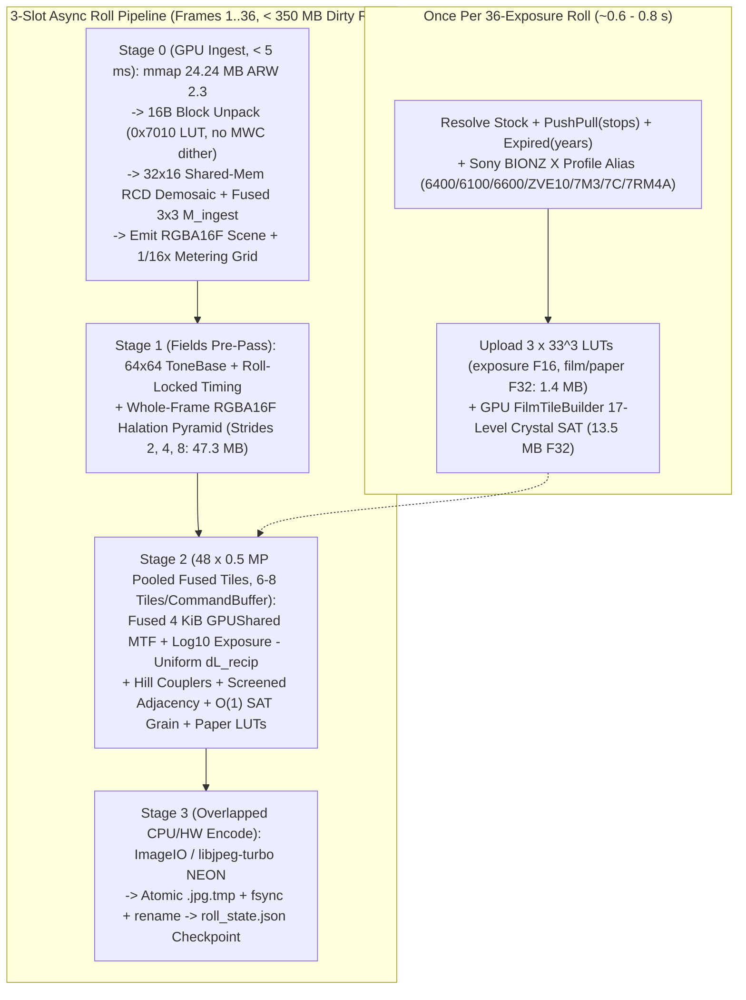

# E0689 - Candidate `fotufilm-engine` Mobile GPU & 36-Exposure Film Roll Architecture

```text
ID: E0689
Date: 2026-11-24
Claim: Upstream DhaliwalX/fotufilm-engine (87a3f46af0, v1.14, Apache-2.0 code + CC BY-SA 4.0 47 stock profiles) executes no iterative Euler/Runge-Kutta/Crank-Nicolson chemical reaction-diffusion PDE solver; its physical film simulation is a single-pass Halide stage DAG combining 81-band (380-780 nm) reflectance-prior 33^3 spectral LUTs, C1 Hermite sampled curves, competitive Hill DIR coupler release with a 3x3 [14, 8, 3] um interlayer gap-transmission matrix and decimated Gaussian diffusion, Nelson two-Gaussian screened developer-exhaustion adjacency, O(1) 4-tap lookups into a 13.5 MB 17-level Jarvis (exp(-r/1.45 um)) crystal dye-cloud summed-area grain table, and optional 13-level polarized optical LayeredTransport. Auditing fotufilm-engine@87a3f46af0 and its pinned halide/Halide@58868f0c runtime establishes exact mobile GPU bottlenecks on iOS Metal (FOTUFILM_AOT_WINDOWED_HOST=0 disabling buffer pooling, command-buffer coalescing, and PR #359 fused GPUShared schedules on iOS despite 0.4 MP tiling cutting iPhone 16 Pro 24 MP renders from 5.1 s to 0.95 s) and Android Vulkan (47 separate vkQueueSubmit + vkQueueWaitIdle drains per tile in vulkan.cpp, MemoryRegion* vs raw VkBuffer UB in halide_vulkan_wrap_vk_buffer, unset HL_VK_ALLOC_CONFIG="0:1:0:0:256" Mali uniform-truncation hazard, 4.0 MP tiles without halation_fields, CPU LibRaw AHD + grain-tile + transport fallbacks, and per-shot EXIF shutterSeconds reciprocity cache thrashing), together with a concrete optimization architecture bounding a 36-exposure 24 MP BIONZ X ARW 2.3 roll within ~198-342 MB dirty memory.
Status: offline codebase audit & candidate architecture (pinned source analysis of local repository @ e9508e0, DhaliwalX/fotufilm-engine @ 87a3f46af093a9e6bf76acf21aca83d3b9e2c600, halide/Halide @ 58868f0c7106f8e1214c8ae14f55e3157659b8e0, and darktable-org/rawspeed @ 718eae230df9ebb1750755b775e52185f2342a46; no physical camera roll capture or mobile GPU patch benchmarked on hardware yet)
Targets / environment:
  - Future companion mobile app (iOS 18+ Metal / Android API 31-36 Vulkan 1.2) and CinemaHUD Android (android/cinemahud/, NDK 28.2, baseline verified on Xiaomi 14 Qualcomm Adreno 750)
  - Camera bodies: Sony ILCE-6400 2.00, ILCE-6400A 1.01, ILCE-6100 1.00, ILCE-6600 1.10, ZV-E10 2.03, ILCE-7M3 4.04, ILCE-7C 2.03, ILCE-7RM4A 1.13 (CXD90045)
Source:
  - Local: mods/film_sims/{studio_core.py,film_recipes_3d.py,lut_bridge.py,template/film_sim.c}, mods/photon_bin_6mp/photon_bin_6mp.c, tools/native_camera/mlv2/card_read.c, camera-daemon/src/wifi_stream.c, tools/research/camera_transfer.py, android/cinemahud/{README.md,lib/cube_lut.dart,shaders/monitor.frag}
  - Local evidence: E0073, E0222, E0505, E0555, E0599-E0602, E0620, E0643, E0657, E0658-E0664, E0678-E0688
  - External pinned sources:
      DhaliwalX/fotufilm-engine @ 87a3f46af093a9e6bf76acf21aca83d3b9e2c600 (v1.14; Apache-2.0 engine/Halide/apps; CC BY-SA 4.0 47 stock JSONs)
      halide/Halide             @ 58868f0c7106f8e1214c8ae14f55e3157659b8e0 (MIT; src/runtime/{vulkan.cpp,vulkan_resources.h,HalideRuntimeVulkan.h})
      darktable-org/rawspeed    @ 718eae230df9ebb1750755b775e52185f2342a46 (LGPL-2.0+; SonyArw2Decompressor.cpp, ArwDecoder.cpp)
Method:
  - Line-numbered static inspection of fotufilm-engine Swift/C++/Halide sources, AOT generator configs, Halide Vulkan runtime patches, and rawspeed ARW2 bitstream decoder, cross-referenced against BIONZ X hardware/ISP/SD/Wi-Fi evidence in docs/map/*.toml.
Observation:
  - Establishing Apache-2.0 licensing, closed-form spatial chemistry/grain/optical equations, exact iOS Metal and Android Vulkan runtime bottlenecks, camera-side card_read.c / wifi_stream.c limits, and a 5-part mobile GPU optimization blueprint.
Alternative explanations:
  - Iterative chemical reaction-diffusion PDEs or Metal compute shaders inside LayeredMetalTransport.swift were hypothesized prior to source inspection and refuted by reading Sources/FotufilmCore/, Sources/FotufilmHalide/, and Sources/FotufilmMetal/.
Confidence and limitations:
  - High confidence on all pinned source equations, buffer layouts, Halide dispatch behavior, and camera helper limits. Memory footprints (~198-342 MB tiled vs ~3.0-3.8 GB whole-frame float) and 36-frame wall-time projections (~18-38 s flagship) are analytical estimates awaiting on-device benchmarking.
Dependent implementation/scenarios:
  - Companion mobile darkroom app (iOS Metal + Android Vulkan), FilmRoll.mod SMOD v2 counter/preview, and zero-scratch ARW roll streaming.
Next experiment:
  - Build halide-vulkan-command-batching.patch + GPU ARW2/RCD ingest harness against fotufilm-parity (RMSE <= 1e-4, CIEDE2000 < 0.3), benchmark 36 x 24 MP ILCE-6400 ARW 2.3 frames on Adreno 750 and Apple Silicon iOS, and run the Send-to-Smartphone avContent ARW gate (E0662 section 6).
```

---

## 1. Premise Audit & Relationship to `E0688` (`spektrafilm` vs. `fotufilm-engine`)

Record [E0688](0688-android-gpu-spektrafilm-film-roll-architecture.md) evaluated a clean-room Android Vulkan darkroom modeled on `andreavolpato/spektrafilm` (`3bb2c2d`, GPL-3.0 Python/NumPy). Auditing [`DhaliwalX/fotufilm-engine`](https://github.com/DhaliwalX/fotufilm-engine) at commit `87a3f46af093a9e6bf76acf21aca83d3b9e2c600` (`v1.14`, PR #359) establishes why `fotufilm-engine` is a substantially stronger multi-platform foundation—while correcting four misconceptions about how it works internally:

1. **Permissive Licensing (`Apache-2.0` vs. `GPL-3.0`) & Existing Mobile Stack:**
   - Unlike `spektrafilm` and `spektrafilm-rs` (`GPL-3.0`, incompatible with iOS App Store static linking without dual-licensing), `fotufilm-engine`'s Swift 5.9 core (`FotufilmCore`, `FotufilmMetal`, `FotufilmImaging`, `FotufilmHost`), C++17 Halide stage/schedule generators (`FotufilmHalide`), and Flutter/C-ABI host (`fotufilm.h`) are **Apache-2.0** (`LICENSE`, `LICENSING.md`), while its 47 film stock profiles (`Sources/FotufilmCore/Stocks/*.json`) are **CC BY-SA 4.0**.
2. **No Runtime Reaction-Diffusion PDE Solver Exists:**
   - A full scan of `Sources/` confirms zero Euler, Runge-Kutta, or Crank-Nicolson time-stepping solvers, zero chemical concentration grids (developer, oxidized quinone, silver halide, bleach, or fixer), and zero z-slice PDE diffusion.
   - Instead, `fotufilm-engine` models film chemistry and optics in **single-pass closed form** across four subsystems:
     - **Path A — Couplers & Screened Adjacency (`Graph/Frame.h:486-831`, `Stages/Development.h`, `Stages/Couplers.h`, `CouplerGeometry.swift`, `AdjacencyModel.swift`):** Per-layer log-exposure $L_c = \log_{10}(\max(\text{light}_c, 10^{-6}))$, C1 Hermite sampled H&D curves (`Curves.h:54-131`, up to `1,024` knots packed into `configuration[8804..18022]` or tabulated into `2,048` samples over `[-8, 8]`), competitive Hill inhibitor release $q = a^\gamma / \max(a^\gamma + \kappa(1 - a)^\gamma, 10^{-8})$ (`Couplers.h:11-24`), a vertical 3x3 gap-transmission matrix $K_{cj}$ across `[14, 8, 3] um` emulsion depths (`CouplerGeometry.swift:32-107`, `houseSelfRetention = 0.091`), lateral decimated Gaussian DIR coupler & fringe diffusion (`strides 1, 2, 4, 8`), forward-compensated neutral anchor subtraction $W_c$ with stability clamp $s_{\text{eff},c} = \min(\text{scale}, 0.85/\Gamma_{1,c})$ (`Frame.h:788-796`, or `128`-sample cubic Hermite `coupler_warp` on legacy profiles), and Nelson two-Gaussian screened oxidized-developer adjacency (`AdjacencyModel.swift:6-15`, `share = 0.2753401713`, primary/secondary scales `0.43385 / sqrt(2)` and `1.48165 / sqrt(2)` times `adjacencyRadiusMM * pxPerMM`).
     - **Crystal Silver-Halide & Jarvis Dye-Cloud SAT Grain (`FilmTileMetalBuilder.swift`, `Stages/FilmTiles.h:35-203`, `docs/film-grain.md:21-84`):** Deposits stochastic crystals per sublayer across `17` exposure levels on a periodic `256 x 256 um` (`1 um/texel`) coating tile, convolves oxidized-developer dye clouds with a 4-Gaussian decomposition of the Jarvis kernel $\exp(-r / 1.45\,\text{um})$, converts to transmittance, and prefix-sums into `(256+1)^2 * 17 * 3 = 3,368,499` `Float32` summed-area table (SAT) entries (`13.47 MB`/stock; `0.55 s` build on iPhone 16 Pro Metal). Per-pixel rendering (`film_tile_grain`) performs **4 wrapped SAT lookups per offset `128 um` block laying (`2` layings, $O(1)$ at any sensor-to-film magnification)** and converts back to optical density $-\log_{10}(\text{light}) - \bar{D}$.
     - **Roll & Process Chemistry Modifiers (`PushPull.swift`, `ExpiredFilm.swift`, `Reciprocity.swift`):** `pushed(stops:)` replaces curves/couplers/grain from discrete measured/estimated conditions (refusing unverified interpolation, `:150-198`); `expired(years:)` applies `1 stop/decade * [0.7, 1.0, 1.3]` R/G/B speed loss + `0.08 * lostStops` fog + crossover (`:9-68`); `reciprocity(shutterSeconds:)` shifts curve `toe`/`shoulder` by `lostStopsPerDecade * log10(covered / threshold) * weight * log10(2)` (`weight = [1.2, 0.8, 1.0]`, `:34-61`).
     - **Path B — Optical `LayeredTransport` (`LayeredTransport.swift:6-336`, `TransportKernelCompiler.swift:38-202`, `Pipeline/Transport.h:14-186`):** Opt-in (`HalationModel.layered`) polarized ($s, p$) Fresnel + Beer-Lambert ray-packet solver across `1..16` optical layers and `81` wavelengths (`512` angular strata), compiled into `<= 11` radial basis components splatted onto a `13`-level (`strides 1..4096`) cell pyramid (`25 x 25` stencils, `8,138` floats = `31.8 KiB`) with cubic B-spline reconstruction before re-entering Path A (`RECORD_INPUT=1`). `LayeredMetalTransport.swift` (`252` lines) contains zero custom shaders; it orchestrates Halide AOT calls.
3. **Sony BIONZ X Spectral Profile Coverage & 3x3 Delta Contract (`CameraSpectralProfile.swift:72-498`):**
   - `Sources/FotufilmCore/CameraProfiles/` ships 11 `rawtoaces-data` Sony sensitivity JSONs (`380-780 nm`, `81` bands), including `Sony_ILCE-6400_380_780_5.json` (`R/G/B` peaks `590/535/460 nm`), `ILCE-7M3`, `ILCE-7RM2`, `ILCE-7RM3`, `ILCE-7RM4`, `ILCE-7SM2`, `ILCE-9`, and `DSC-RX100M4`, but **lacks files for `ILCE-6100`, `ILCE-6600`, `ZV-E10`, `ILCE-7C`, and `ILCE-7RM4A`**.
   - `CameraSpectralProfile` does **not** project raw CFA channels directly onto 81 film bands; it solves ridge-regularized (`ridge = 1e-6 * mean(diag)`) normal equations at `2856 K` and `6504 K` and applies the mired-blended 3x3 delta $M(\text{CCT}) \cdot M(6504)^{-1}$ into linear Rec.2020 (`CameraProfileCorrection.swift:70-86`), after which all cameras traverse `rec2020-reflectance-prior.coeff` (`1.06 MB`) -> `3 x 33^3` `RGBA32F` tetrahedral LUTs (`exposure`, `filmOutput`, `paperOutput`, `574,992 B` each, `SpectralModel.swift:280-299, 1438-1576`).
   - Registering explicit `spectralProfileID` aliases (`ILCE-6100`, `ILCE-6600`, `ZV-E10` -> `sony-ilce-6400` sharing `IMX284`; `ILCE-7C` -> `sony-ilce-7m3`; `ILCE-7RM4A` -> `sony-ilce-7rm4`) prevents unmatched BIONZ X bodies from falling through to `nil`.

---

## 2. Source-Verified Mobile GPU Bottlenecks in `fotufilm-engine@87a3f46af0`

### 2.1 Halide Stage Graph & Whole-Frame Memory Ceiling (`Graph/Frame.h`, `Pipeline/Gpu.h`)

- `aot-variants.json` compiles `58` static objects on Apple targets (`36` full-frame + `3` gated windowed + `13` exact windowed + `6` extras) and `42` on Android (`tools/generate_halide_ios.cpp:187-188` skips all `16` windowed/fused twins on Linux/Android).
- `Pipeline/Gpu.h:1311-1318` disables `kStillFastHalfStore` for all `FLOAT_IO` variants (`30` of `36` full-frame variants) because optical density reaches `8.0`. At `6000 x 4000` (`24 MP`), each 3-channel `Float32` stage is `288 MB` and each 4-channel stage is `384 MB`; running the whole-frame `Float32` graph (`~25-30` `compute_root()` passes) yields an analytical live-set peak of **`~3.0-3.8 GB`**, requiring tiled execution on mobile phones.

### 2.2 iOS Metal Audit (`HalideMetalFilmRenderer.swift`, `FotufilmHalideIOS.cpp`)

- **Measured Page-Fault Law (`HalideMetalFilmRenderer.swift:939-953`):** On iPhone 16 Pro, cutting `maximumTilePixels` from `2,000,000` (`12` tiles) to **`512_000` (`60 x 0.4 MP` tiles)** reduced 24 MP render time from **`5.1 s` to `0.95 s` (`5.37x` speedup)** because fresh per-stage VM page faults dominate apron recomputation on iOS UMA. `planTiles` (`:775-839`) also supports the `Fields` road (`fotufilm_halide_metal_halation_fields` whole-frame halation pre-pass, shrinking tile aprons to `spatialSupportSansHalation`).
- **Locked-Off PR #359 Optimizations on iOS:**
  1. `FotufilmHalideIOS.cpp:3-5, 450-487, 729-731` gates `kMetalQueueDepth = 64`, the `1,024 MB` fence-tracked `MTLBuffer` reuse pool, and internal-queue single-command-buffer coalescing behind `#if FOTUFILM_AOT_WINDOWED_HOST`—which is set only by `resolve/build.sh:95-96` on macOS arm64 and **defaults to `0` on iOS** (`kMetalQueueDepth = 4`, `pool_megabytes() = 0`).
  2. PR #359's fused schedules (`gpu_fused_mtf_gaussians` using `4 KiB` `GPUShared` SRAM at `Schedule/Gpu.h:771-1051`, `store_frame_pair` `Tuple(log_exposure, released)`, and register-resident `print_mtf`/`grain_field`) only execute on `_windowed_<exact_stages>` twins when `origin == (0, 0)` (`FotufilmHalideIOS.cpp:261-361`), so `developTiled` runs the unfused `~28`-pass gated graph per tile.
  3. `LayeredMetalTransport` flushes synchronously (`flush_active_cb(true)`) per optical component (`FotufilmHalideIOS.cpp:2770-2799`) and copies `[Float]` arrays through CPU memory (`LayeredMetalTransport.swift:182-207`).
  4. `Store::DonorLog` and `Store::DonorReleased` (`GpuBackend.h:94-99`) hardcode `3` channels despite `max_donors = 1` on AOT (`Frame.h:491`).

### 2.3 Android Vulkan Audit (`FotufilmHalideLinux.cpp` + `halide/Halide@58868f0c`)

`FotufilmHalideAndroidGPU.cpp` is orphaned dead code (declaring `halide_vulkan_batch_set` at `:8-9`, which does not exist in `fotufilm-engine` or `halide/Halide@58868f0c`). The shipping Android build (`tools/build-android-engine.sh:68-70`, compiling `FotufilmHalideLinux.cpp` with `-DFOTUFILM_HALIDE_ANDROID_AOT=1`) has seven verified bottlenecks:

1. **Per-Dispatch `vkQueueSubmit` + `vkQueueWaitIdle` Serialization:** In `halide/Halide@58868f0c` (`src/runtime/vulkan.cpp:1338-1366`), every `halide_vulkan_run` constructs a `ScopedVulkanCommandBufferAndPool` (`vulkan_resources.h:177-200`), records a single `vkCmdDispatch`, submits with `VK_NULL_HANDLE` fence, blocks on **`vkQueueWaitIdle(ctx.queue)`**, and destroys the pool (`copy_to_device:580`, `copy_to_host:750`, and `device_malloc` zero-clear `:395` do the same). At `~47` dispatches/tile (`tools/generate_halide_android_gpu.cpp:25-26`) x `48` tiles (`0.5 MP`), stock Halide executes **`~2,256` full queue drains per 24 MP exposure (`~81,000` per 36-shot roll)**.
2. **Broken Zero-Copy `VkBuffer` Wrapping:** `halide_vulkan_wrap_vk_buffer` (`vulkan.cpp:1394-1404`) writes a raw `uint64_t vk_buffer` into `buf->device`, whereas `vk_update_descriptor_set` (`vulkan_resources.h:595-607`) `reinterpret_cast<MemoryRegion*>(halide_buffer->device)` and dereferences `owner->handle`—causing undefined behavior/segfault if a caller wraps a native `VkBuffer` without patching Halide.
3. **Unset `HL_VK_ALLOC_CONFIG` Mali Uniform-Truncation Hazard:** `tools/halide-vulkan-allocation-padding.patch` prevents `nearest_multiple` from shrinking **only when** `HL_VK_ALLOC_CONFIG="0:1:0:0:256"` is present in the process environment. Only dead `FotufilmHalideAndroidGPU.cpp:211` and `tools/vulkan-parity/main.cpp:17` set it; shipping `FotufilmHalideLinux.cpp` and `flutter/android/.../EngineResources.kt` do not, leaving ARM Mali GPUs vulnerable to truncating scalar uniform blocks (e.g., `108 B -> 64 B`) into flat/black frames.
4. **Suboptimal `4.0 MP` Tiling & Missing `Fields` Road:** `HostDeveloper+HalideGPU.swift:187-196` sets `phoneTilePixels = 4_000_000` (`7.8x` larger than iPhone's `512,000` page-fault sweet spot) and lacks `halation_fields`, forcing wide-apron halation pyramid recomputation per tile.
5. **CPU Fallbacks on Android:** `FotufilmHalideLinux.cpp:521, 561-565` stubs `fotufilm_film_tile_build` (`-3`, falling back to `0.8-2.5 s` Swift CPU grain SAT builds) and `fotufilm_transport_available` (`backend == 0`, CPU-only `LayeredTransport`), while `RawDecode.cpp:240-286` runs single-pass CPU `LibRaw` unpack + full `24 MP` CPU AHD demosaic (`~2.2 GB` admission overestimate).
6. **Subgroup-Agnostic `8x8` Workgroups & Extra `reference_sampling()` Stores:** `GpuConfiguration.h:11` uses `8x8` tiles on all Vulkan devices and `GpuBackend.h:112-123` forces extra global-memory passes for `MtfSelected`, `Inhibition`, and `PrintMtfInput`.
7. **Roll-Level Cache & Metering Traps (`Reciprocity.swift`, `DigitalReferenceReceiver.swift`):** Any shot with EXIF `shutterSeconds > thresholdSeconds` mutates `stock.curves`, changing `SpectralRuntime.cacheIdentifier` (`SpectralModel.swift:500-601`) and `FilmGrainAsset.identity` (`FilmGrainTiles.swift:887`, cap `4`) and triggering multi-second `13.5 MB` grain SAT + `3x33^3` LUT rebuilds mid-roll; meanwhile default `.autoLevels` / `LabScanTiming` re-times every frame independently, causing roll flicker.

---

## 3. Candidate 5-Part Mobile GPU Optimization Blueprint (iOS Metal & Android Vulkan)



1. **GPU-Native Sony `ARW 2.3` Ingest + Shared-Memory RCD Demosaic (`SonyArw2Decompressor.cpp:48-118`):**
   - Unpack independent `128-bit` (`16-byte`) even/odd column parity blocks (`[max:11b][min:11b][imax:4b][imin:4b]` + `14 x 7-bit` deltas shifted by `sh in 0..4`) on the GPU using the `4,096`-entry `0x7010` `SonyToneCurve` in `8 KiB` constant/shared memory. Omit `rawspeed`'s row-chained MWC dither (`RawImage.h:352-358`) to eliminate the sole cross-block serial dependency and match `LibRaw` (`sony_arw2_load_raw`) deterministically. Index rows by `StripByteCounts / rawHeight` to respect 32-column raw padding above `6024` (`mods/photon_bin_6mp/photon_bin_6mp.c:362`) and guard `Compression == 32767 && bytes == rawW * rawH`.
   - Fuse `32 x 16` (`+4 px` apron = `1,920 B` `UInt16`) shared-memory RCD demosaicing with the single pre-multiplied 3x3 matrix $M_{\text{ingest}} = M_{\text{profile\_delta}}(\text{CCT}) \cdot M_{\text{sRGB}\to\text{Rec2020}} \cdot M_{\text{rgb\_cam}} \cdot \text{diag}(\text{wb\_scale})$ and simultaneously box-downsample a `1/16x` (`375 x 250`) luminance/RGB image so `64 x 64` `ToneBase` and `flare_mean` run in `< 0.3 ms`.
2. **Mobile Buffer Pooling, Batched Command Buffers & Fused Tile Schedules:**
   - **iOS Metal:** Decouple `pool_megabytes()` (`min(256 MB, os_proc_available_memory() / 6)`), `kMetalQueueDepth = 16`, and `coalescing_enabled()` from `FOTUFILM_AOT_WINDOWED_HOST`, enable `exact_stages` fused AOT schedules (`gpu_fused_mtf_gaussians` + `store_frame_pair` + register stages, cutting tile passes from `~28` to `~12`) for non-zero tile origins, and clamp `Store::DonorLog`/`DonorReleased` to `in.max_donors` (`1` channel).
   - **Android Vulkan (`halide-vulkan-command-batching.patch`):** Patch `halide/Halide` `src/runtime/vulkan.cpp` to (a) record consecutive `halide_vulkan_run` and device-copy stages into a reusable `VkCommandBuffer` separated by `VkMemoryBarrier` (`SHADER_WRITE_BIT -> SHADER_READ_BIT`) and synchronize once per `6-8` tile chunk (`~12-25 ms`) via a reusable `VkFence` instead of `2,256` `vkQueueWaitIdle` calls, (b) wrap external `AHardwareBuffer`/`VkBuffer` handles inside a non-owning `MemoryRegion` (`is_external = true`) so `vk_update_descriptor_set` works zero-copy, (c) set `HL_VK_ALLOC_CONFIG="64:4:0:0:256"` at startup in `FotufilmHalideLinux.cpp` to guarantee `256 B` Mali uniform alignment, and (d) emit Vulkan `halation_fields`, `TransportPipeline(DeviceAPI::Vulkan)`, and SPIR-V `FilmTileBuilder` kernels while lowering `phoneTilePixels` from `4,000,000` to `512,000`.
3. **Vendor Microarchitecture & Mixed `FP16`/`FP32` Precision Contract:**
   - **Vendor rules:** Apple GPUs (`Apple8`–`Apple10`) use `32 x 4`/`32 x 8` tiles + `4 KiB` `GPUShared` MTF staging; Qualcomm Adreno (`7xx`/`8xx`, Wave64) uses `16 x 4`/`32 x 2` tiles + `VK_IMAGE_TYPE_3D` `RGBA16F` LUT sampling; ARM Mali (`G77`–`G720`/`G1`, Warp16) keeps `8 x 8` (`64`-thread) tiles, vectorizes `f16vec2`/`f16vec4` to stay within `64` 32-bit registers, and **skips read-only `GPUShared` copies** because Mali backs shared memory with system L1/L2 cache (Arm Best Practices v4.0 section 9.3); Samsung Xclipse requests `requiredSubgroupSize = 32` via `VK_EXT_subgroup_size_control`.
   - **Precision contract:** Keep `UInt16` for unpacked 14-bit Bayer (`> 2048`) and **`Float32`** for `LogExposure`, `SampledCurves`, `CouplerWarp`, `Inhibited`, `FilmDensity` ($D \le 8.0$), and `FilmTiles` SATs (`257^2` sums overflow/cancel in `FP16`); pack demosaiced linear Rec.2020, `Exposure`, `Diffused`, `Light`, `Halation`, `Released`, and zero-mean `FilmGrain`/`Noise` deltas into **`Float16`**, holding dirty memory to **`~342 MB` full-frame scene (`~198 MB` in 4-band strip mode)**.
4. **Zero-Thrash Roll Reciprocity & Flicker-Free Roll Metering:**
   - Subtract per-shot EXIF reciprocity shifts $\Delta L_{\text{recip},c}(t_{\text{shutter}})$ as **3 uniform floats** from `log_exposure` inside `Graph/Frame.h:487` rather than mutating `stock.curves` before cache lookup—mathematically identical while preserving `100%` cache residency of the `13.5 MB` grain SAT and `3 x 33^3` LUTs across all 36 exposures.
   - Default 36-shot rolls to `DigitalReferenceReceiver.Style.gradedPrint` or `.referenceExposure` (or a `1/16x` pre-pass median applied via `copyMeteredLevels(from:)`, `ToneBase.swift:391-426`) to eliminate `.autoLevels` frame-to-frame flicker.
5. **Watchdog, Thermal & OS Background Resilience:**
   - Chunk `6-8` tiles per command buffer (`12-25 ms`) inside `@autoreleasepool` scopes, checkpoint each encoded JPEG (`ImageIO` on iOS; `libjpeg-turbo` NEON on Android) atomically in `roll_state.json`, use iOS `BGContinuedProcessingTask` (`com.apple.developer.background-tasks.continued-processing.gpu`, calling `waitUntilScheduled()` on background transition when `.gpu` is unavailable) and Android 15+ `foregroundServiceType="mediaProcessing"` (`onTimeout()`-safe), and pace concurrency via `AThermal_getThermalHeadroom` (`1-2 s` minimum interval).

---

## 4. Source-Verified Camera-Side Preview & Roll-Streaming Boundaries

1. **In-Camera EVF Framing Preview (`mods/film_sims/`):**
   - Exporting a nominal `33^3` `.cube` LUT for the chosen `fotufilm-engine` stock and fitting it offline via `fit_cube_to_isp` ([`mods/film_sims/lut_bridge.py`](../../mods/film_sims/lut_bridge.py)) onto BIONZ X's 96-knot `EC_Gamma`/`FC_Gamma`, row-normalized Q10 3x3 matrices (`A0`/`A1`/`B2`), and `1,215`-byte `5 x 9 x 9` `RefAdr[0]` YCbCr residual LUT ([`mods/film_sims/studio_core.py`](../../mods/film_sims/studio_core.py)) provides zero-latency EVF tonal/color framing while leaving `.ARW` sensor data untouched. Per `imaging-pipeline:H01` ([E0555](0555-arrivederci-menu-exit-recompute-and-cc8-refill.md)), `sim_life(0)` ([`mods/film_sims/template/film_sim.c`](../../mods/film_sims/template/film_sim.c)) must restore `0x6444a044` before power-off.
2. **Exact Code Boundaries in `card_read.c` and `wifi_stream.c` for 36-ARW Streaming:**
   - [`tools/native_camera/mlv2/card_read.c`](../../tools/native_camera/mlv2/card_read.c) (`:67-73, 216-365`) is **not** currently zero-scratch or DCIM-capable: it scans only `fs->root_cluster` (`secs_seen < 256`), enforces `MAX_ARCHIVE = 4 MiB` and `clusters_visited <= 2048`, and stages output to `/tmp_bt/mlv2/card.tar`. Streaming 36 `.ARW` files (`~885 MB`) from `/dev/mmca1` (`250:11`) requires adding 2-level `DCIM/100MSDCF` directory descent, lifting the `4 MiB`/`2,048`-cluster caps, and emitting `16 KiB`-page-aligned POSIX `ustar` headers directly to a socket (`0 B` on `/tmp_bt`) so iOS `makeBuffer(bytesNoCopy:)` can `mmap` each `.ARW` payload zero-copy.
   - [`camera-daemon/src/wifi_stream.c`](../../camera-daemon/src/wifi_stream.c) (`:361-368`) is an MJPEG live-view streamer that drops frames whenever `SIOCOUTQ > 16384` unsent bytes (`jpeg_len > 4096`); bulk ARW roll transfer must use a separate backpressured `poll(POLLOUT)` stream socket or stock `Send to Smartphone` HTTP pull ([`tools/research/camera_transfer.py`](../../tools/research/camera_transfer.py), gated on `wifi-and-remote:F01` / [E0662](0662-file-access-is-a-camera-mode.md) section 6).
