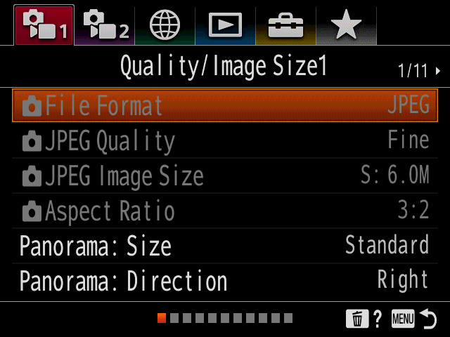
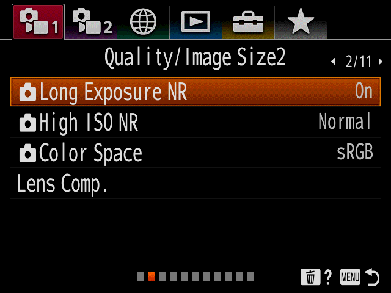

# External ZV-E10 QEMU adapted-menu receipt

Date: 2026-11-21. Contributor: `qn06142`. Scope: an offline ZV-E10 (`CXD90045`)
experiment in a separate local workspace, **not a new upstream stock-boot
milestone or hardware contract**. Related discussion: [ZV-E10 findings, #50](https://github.com/ivica00/bionz-x-research/issues/50).

## What was observed

The standalone QEMU 11.1.2 `zve10` machine displayed the original Sony menu
application and resources through an explicit application adapter. The initial
English menu and a second page were captured through QMP and compared, pixel
for pixel, with independently decoded guest physical RGBA4444 memory. The menu
application, layouts, icons and English text were Sony inputs; host code did
not draw or translate the menu.





The sanitized [receipt](receipt.json) records source/input hashes, both PNG and
raw-frame hashes, native input receipts, completed-frame counters, normal
transport shutdown and QEMU return code zero. No firmware, backup, CPIO, shared
library, kernel module or raw framebuffer bytes are included.

## Fidelity boundary

| Path | Result and qualification |
| --- | --- |
| Stock ZV-E10 kernel/initrd and synthesized eMMC | Local tests reached an ash prompt and checked nine mounts. Normal startup was separately narrowed to a wait at stock `drivers2` module 17, `upm.ko`, after modules 0-16 returned success. This does not establish the next hardware dependency. |
| Adapted menu | A reference UI kernel, AP-only `target=qemu`, `dmode=3` service selection, DMA330 stub, and CPU implementations of supported GPU/LDEC operations run the original menu code. Hooks change execution in memory. This bypasses normal startup. |
| CPU | The adapter used an explicit broad Cortex-A9 compatibility profile. The separate stock profile retained VFPv3-D16/no-NEON. The cause of the adapter's observed CPU-profile dependency was not isolated. |
| Input | UART commands injected native function events. Vertical wire labels required correction; after-draw state was awaited after consumption. This is not physical button/ADC/FRONT emulation. |
| English | Original English text banks were overlaid at the bank paths selected by the captured Japanese locale, in the generated image only. This is not a camera-region conversion or a captured-settings modification. |
| Graphics | The complete initial frame and page-2 header have reviewed pixel oracles. Some focused-row redraws after vertical input remain incomplete. Queue consumption and changed pixels do not prove every control or draw operation correct. |
| Not demonstrated | Full stock boot to a menu; real-camera execution of this adapter; physical controls; live view; capture/recording; USB/PTP; complete power management or GPU/LDEC coverage. |

This comparison does not supersede the upstream a6400 results in
[E0521](../0521-qemu-a6400-main-firmware-boots-to-avcam.md) or
[E0665](../0665-qemu-boots-from-the-public-updater.md). The backup preload is
already documented by [E0031](../0031-backup-boot-parameters-and-ram-mapping.md)
and E0521; it is not claimed as a new discovery here.

## Useful follow-up findings

### Publish a selected, retired frame rather than the last present call

The first local bridge published every completed software GPE present. A
multi-pass transaction could leave an incomplete intermediate buffer selected
for display. The revised bridge publishes the adapter's selected valid buffer
only when its transaction retires. Its condition was:

```c
ne_retired_frame = frame;
if (ne_latest_valid && ne_latest.frame == frame)
    pmca_menu_present(ne_latest.physical);
```

The guest bridge writes the selected PA to OSD0 `STARTADRS` (`0xf3441320`),
pitch 1280 (`0xf3441324`), and control 3 (`0xf3441300`). The local OSD model
completes 3 to 2. These are adapter/display-model operations, not a newly
verified physical transaction or a recommendation to bypass upstream fences.

The host stops QEMU, reads the selected PA, captures the QEMU console,
independently decodes 640x480 little-endian RGBA4444, compares every RGB pixel,
and resumes execution. Native event consumption is followed by an observed
later after-draw frame; consumption alone preceded deferred view work.

### Avoid an init diagnostic process storm

The inherited UI init script ran a per-process/per-thread diagnostic dump with
many `cat` subprocesses. A retained failing run reported `Cannot allocate ASID`
and then `Kernel panic - not syncing: Attempted to kill init!` around guest
88 seconds. Removing that dump and keeping PID 1 in a builtin application
wait allowed a later menu/navigation regression to complete in 157.18 host
seconds with normal shutdown. This is an observed failure and successful
workaround, not a decoded ASID allocator contract or proof of a kernel fix.

The generated runtime retains module loading and the application launch, then
uses a builtin `wait` and a bounded-frequency keepalive if the application
returns. It does not execute the diagnostic process sweep. UART/QMP diagnostic
receipts remain available without those guest subprocesses.

## Provenance and reproduction limits

The adapter was derived from
[`chocotan/zve10-qemu` at `42554a639e005455a1cc492744bd77341e7c41d2`](https://github.com/chocotan/zve10-qemu/commit/42554a639e005455a1cc492744bd77341e7c41d2).
Credit: copyright 2026 chocotan, MIT-licensed adapter; original Sony firmware
and resources remain separate inputs. QEMU components retain their own license.
The reference checkout had pre-existing script modifications. Its HEAD alone
therefore does not identify all copied sources; the receipt pins the actual
source-file hashes and the prepared UI-kernel/CPIO identities.

The contributor implementation was an uncommitted local worktree based on
`11d8b25983898801270217fa04f1aaca73f5e55b` in `qn06142/zv-e10-re`. That base is
not asserted to be publicly available. Exact implementation hashes are retained
in the receipt. **The initial PR revision contributed an external experiment receipt and
screenshots in its initial documentation-only revision.** The subsequent
[upstream board integration](../../ZVE10_ADAPTED_MENU.md) adds a separate
launcher and replay, documented in [integration validation](integration-validation.md).
Private prepared inputs are still required; the original commands below remain
specific to the contributor checkout.

The contributor ran, from that local checkout:

```powershell
.\.venv\Scripts\python.exe -m emulator.menu --language english --output <output>/menu.png --key DOWN --key UP --key RIGHT --key LEFT
.\.venv\Scripts\python.exe -m pytest tests/e2e_qemu/test_menu_runtime.py -q
.\.venv\Scripts\python.exe -m pytest tests/test_emulator_runner.py tests/test_housekeeping.py tests/e2e_qemu/test_stock_milestones.py -q
.\.venv\Scripts\python.exe scripts/check_research.py
```

Recorded local results: menu E2E `1 passed in 102.80s`; stock/CPU/housekeeping
`20 passed, 4 subtests passed in 16.28s`; research checker verified 27 evidence
files and 31 experiment records. Those are **contributor-local results**, not
new test counts or compatibility claims for this repository. The receipt also
records the unchanged-reference guard result. Complete private UART logs were
retained locally; their full contents and proprietary inputs are not published.

The stock udate NULL-address failure was avoided by retaining the capture's
uncached reservation `memrsv=680M@0x15800000:uc`, covering PA `0x200210e4`.
That observation is ZV-E10/capture-specific and is not an a6400 mapping change.

## Next upstream work

Independently qualify identities and replay the relevant path before adopting
any model behavior. Compare the `upm.ko` wait with native FRONT/power-management
producers; retain the existing a6400 boot baseline. Treat the menu adapter as
an explicitly named comparison profile, not progress of the stock machine.
Investigate incomplete focus redraws and the CPU-profile dependency separately.
